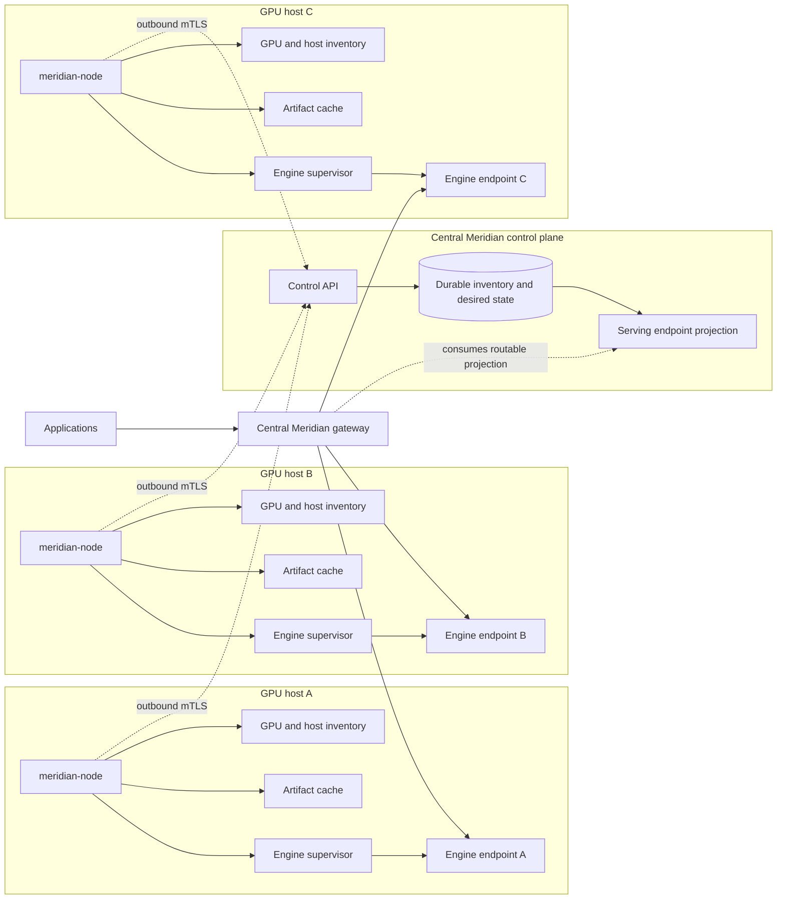
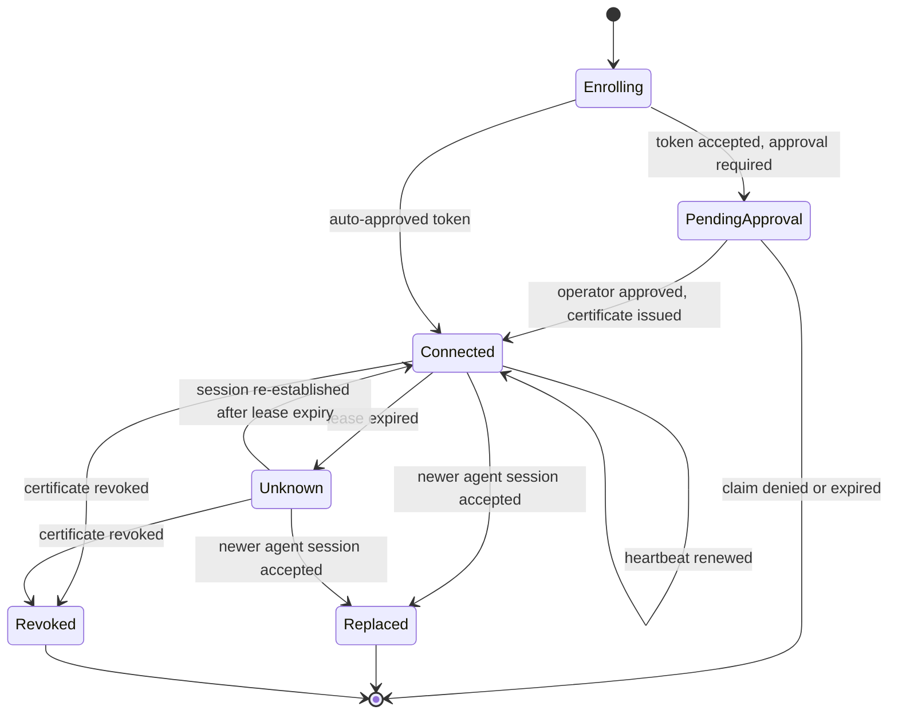
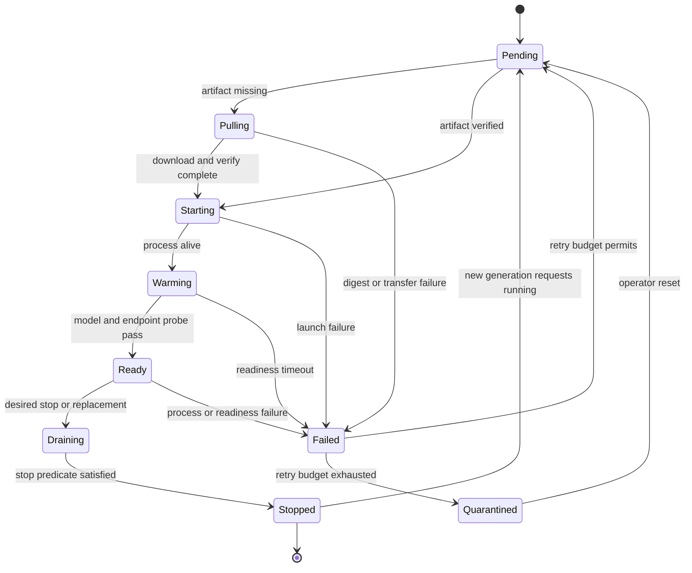

# Meridian Node Agent Design

**Status:** Implemented (Phases 0–5). mTLS enforced end to end with rotation +
revocation/CRL, gateway projection wired, capacity-aware placement (locality,
load, MIG, NVLink), Alembic-managed schema, cross-repo connection verified with
numbers and in CI (Sections 1.1, 20, 24). Drivers: vLLM, Ollama, generic-OpenAI,
TGI, SGLang, llama.cpp, LMDeploy. Modes: observe-only, managed-host,
kubernetes-integrated, air-gapped. The gated GPU host tests are executed on an
RTX 4060. The one remaining item is load-driven batched observation writes at
fleet scale (connection pooling is in place).

**Repository:** `IMV-IN/meridian-node`

**Companion repository:** `IMV-IN/Meridian`

**Authors:** IMV-IN

**Last updated:** 2026-08-04

### Normative language

The terms **MUST**, **MUST NOT**, **REQUIRED**, **SHOULD**, **SHOULD NOT**, and
**MAY** are normative. Examples illustrate the contract but do not override the
versioned JSON Schema and OpenAPI definitions. When prose and a released schema
conflict, the released schema is authoritative for wire compatibility and this
RFC must be corrected.

## 1. Executive Summary

`meridian-node` is a privileged, host-local agent for GPU inference servers. It
connects outbound to a central Meridian control plane, reports host/GPU/model/
engine state, reconciles an approved desired state, supervises inference
engines, and reports when an endpoint is genuinely ready to serve traffic.

The agent is deliberately a separate repository and deployable from the central
Meridian gateway. The gateway is the fleet's authenticated API and routing
authority. The node agent is the host's execution authority. Neither component
should silently become the other:

```text
Central Meridian decides WHAT should run and WHETHER it may receive traffic.
meridian-node decides HOW to make it run safely on one GPU host.
```

The first implementation must not attempt to replace Kubernetes, Slurm,
Terraform, Ansible, Docker, or systemd as a general scheduler. It should provide
a narrow, declarative contract for a Meridian-managed inference assignment and
use the host's native runtime where possible.

### 1.1 Implementation status

As of 2026-08-04 the agent is implemented through Phases 0–5, with adapter seams
at the hardware and network boundaries (NVML, Docker, mTLS HTTP), fake-driven per
the testing strategy in Section 20. All four
modes are implemented — observe-only, managed-host, kubernetes-integrated (Section
6.3, read-only observation), and air-gapped (Section 6.4, signed bundles) — and
seven engine drivers (vLLM, Ollama, generic-OpenAI, TGI, SGLang, llama.cpp,
LMDeploy). The central control plane exists as `meridian-control` in the Meridian
repository: FastAPI + SQLAlchemy (SQLite by default, Postgres via a URL), a
built-in Ed25519 CA issuing real node certificates, and restore-safe fencing per
Section 17.5.

The two gates that previously blocked managed-host production are **closed**:

- **Transport authentication is enforced (Section 15.6).** After enrollment the
  agent presents its client certificate on every call; the control plane's
  `verify_node_identity` binds the certificate's SAN `node_id` to the path (a
  no-cert call is rejected with `NODE_NOT_AUTHORIZED`). `require_mtls` is
  default-off for dev and enabled behind the TLS-terminating edge. Certificates
  rotate automatically before expiry.
- **The gateway consumes the serving projection.** `meridian-control` publishes
  Ready engines (with served model), and the gateway's `ManagedProjectionSync`
  registers routable managed engines as dynamic backends.

The full `node ↔ control ↔ gateway` path is verified end to end with mTLS
enforced, with measured numbers — see Section 20 ("End-to-end connection
verification"), and a dedicated control-plane CI job runs the cross-repo tests on
every change. Phase 5 placement is in — capacity reporting, VRAM/MIG enforcement
at launch, and control-side capacity-aware selection (artifact locality,
queue-depth-aware load, NVLink affinity). The gated GPU host tests have been
executed on an RTX 4060. What remains (Section 24) is one operational item —
load-driven batched observation writes at fleet scale (connection pooling is in
place).

## 2. Decision Summary

This RFC makes the following decisions:

1. `meridian-node` is a separate repository, package, binary, container, and
   release train.
2. The agent initiates all control-plane connections. The control protocol does
   not require an inbound agent listener. First-release application traffic uses
   a separate private gateway-to-engine network path and therefore does require
   an engine serving port reachable from Meridian gateway nodes.
3. Agent-to-control-plane communication uses HTTPS with node identity, with
   mTLS as the target production mechanism. A short-lived enrollment token is
   allowed only for bootstrap.
4. The protocol is versioned, JSON-based HTTPS for the first release. It uses
   heartbeat plus long-polling before introducing a persistent streaming protocol.
5. Desired state is declarative and generation-based. The agent reconciles a
   complete snapshot idempotently; it does not execute arbitrary shell commands
   from the server.
6. Model artifacts are content-addressed and verified before use. Mutable model
   aliases are resolved centrally to immutable revisions and digests.
7. Engine lifecycle is represented by explicit states and conditions. Process
   liveness, model readiness, agent lease, and gateway routability are separate.
8. The central control plane must drain an endpoint before the agent stops or
   replaces an engine.
9. Static YAML backends remain supported in Meridian. Node-managed engines are a
   second inventory provider during migration.
10. Kubernetes-native engine workloads are preferred in Kubernetes deployments.
    The node agent should not launch host processes that compete with a cluster
    scheduler unless that mode is explicitly selected.
11. The first managed deployment profile is a Linux GPU host running a pinned
    vLLM OCI container through Docker Engine. Observe-only mode may support other
    environments earlier, but their process lifecycle is not managed.
12. Production managed-host mode is blocked until mTLS enrollment, credential
    rotation, revocation, lease fencing, and artifact verification are enabled.
13. The node control-plane API is `meridian-control`, a separate service and
    deployable in the central Meridian repository and release train. The
    data-plane gateway consumes its serving projection read-only.
14. Node certificates are issued by a built-in minimal CA inside
    `meridian-control`, behind a pluggable signer interface so cert-manager or
    an enterprise PKI can replace it without protocol changes.
15. Enrollment is approval-gated by default: a valid bootstrap token creates a
    pending claim that an operator must approve before a certificate is issued.
    Tokens may carry an explicit `auto_approve` flag for trusted provisioning
    pipelines.
16. The v1 protocol is engineered for a 100-node fleet and validated with
    headroom to 500 nodes. Batched observation writes and streaming transports
    are deferred until a fleet exceeds that envelope.

## 3. Goals and Non-Goals

### 3.1 Goals

- Give each GPU host a stable, cryptographically bound identity.
- Discover NVIDIA GPUs, including MIG devices where available.
- Report agent, host, GPU, artifact, and engine observations to Meridian.
- Maintain a lease so stale or partitioned nodes stop receiving new traffic.
- Reconcile approved engine assignments after agent or engine restarts.
- Manage model artifacts with resumable transfer, digest verification, atomic
  promotion, and disk-pressure safety.
- Support a small driver interface for vLLM, SGLang, Ollama, and generic
  OpenAI-compatible engines.
- Expose engine readiness only after the requested model revision is loaded and
  the endpoint contract has passed.
- Support graceful drain and bounded shutdown.
- Preserve operation during temporary control-plane outages using the last
  accepted desired state and explicit safety limits.
- Provide auditable, structured state transitions without logging prompts or
  generated content.
- Make protocol compatibility independently testable across repositories.

### 3.2 Non-goals for the initial design

- General-purpose host orchestration.
- Arbitrary remote command execution.
- Central SSH management.
- GPU scheduling across arbitrary workloads.
- Replacing Kubernetes, Slurm, or an existing infrastructure provisioning system.
- Automatic model selection based on prompt content.
- Distributed inference across nodes.
- A public model marketplace or model licensing service.
- Collection of prompts, completions, or raw application payloads.
- Full engine-specific optimization in the first agent release.

## 4. Terminology

| Term | Meaning |
|---|---|
| Control plane | Central Meridian APIs and durable state that define identity, desired assignments, leases, and routability. |
| Node | One physical or virtual host running `meridian-node`. |
| Host boot ID | Operating-system boot identity. It changes on host reboot, not agent restart. |
| Agent session ID | A random identifier generated on every agent process start. It fences messages from prior agent processes. |
| GPU device | A physical GPU or MIG compute instance with a stable device identifier. |
| Artifact | An immutable model/runtime payload identified by a digest. |
| Engine assignment | A desired declaration to run one engine/model endpoint on a node. |
| Engine instance | The observed local process/container corresponding to an assignment. |
| Endpoint | The OpenAI-compatible HTTP endpoint exposed by an engine instance. |
| Lease | A time-bounded permission for a node session to remain active in the control plane. |
| Generation | Monotonically increasing desired-state version for a node or assignment. |
| Admission | The central gateway's decision to send new requests to an endpoint. |
| Drain | Transition in which an endpoint receives no new work while existing work completes. |
| Condition | A typed status statement with truth value, reason, message, and observation time. |

## 5. Product Boundary



### 5.1 Central Meridian owns

- Application-facing OpenAI-compatible API.
- Tenant authentication, authorization, budgets, and policy.
- Fleet-level desired state and assignment ownership.
- Node enrollment, certificate lifecycle, and lease status.
- Placement decisions and assignment approval.
- Admission into the serving pool.
- Endpoint draining coordination.
- Fleet-wide audit metadata and operator views.
- Aggregation of node observations and serving metrics.

### 5.2 `meridian-node` owns

- Local host and GPU inventory.
- Local artifact cache and digest verification.
- Translation of an approved assignment into a validated engine invocation.
- Engine process/container lifecycle.
- Local readiness probes and restart backoff.
- Local state durability across agent restarts.
- Reporting observed state and conditions.
- Refusing unsafe or impossible assignments.

### 5.3 Infrastructure systems own

- Host provisioning and patching.
- GPU driver and device-plugin installation.
- Network, DNS, firewall, and TLS trust distribution.
- Kubernetes/Slurm scheduling when the deployment uses those systems.
- Registry and artifact mirror availability.
- Secret bootstrap policy.

## 6. Operating Modes

The agent must support explicit modes rather than inferring ownership from the
environment.

### 6.1 Observe-only

The agent discovers existing engines and reports them. It cannot start, stop,
or replace processes. This is the default for initial installation and the
recommended migration mode.

### 6.2 Managed-host

The agent may manage processes or containers listed in approved desired state.
Drivers and resource policies are local allow-listed configuration. It may not
execute arbitrary commands supplied by the control plane.

### 6.3 Kubernetes-integrated

The agent reports node/GPU inventory and may manage a narrow local cache, while
the central controller creates native Kubernetes workloads. The agent does not
launch a second copy of a Kubernetes-managed engine.

**Implemented.** This mode has no runtime, root helper, or reconciler, so it is
structurally incapable of launching an engine (`managed_allowed()` is false and
`attach_reconciler` refuses it). Instead a read-only `KubernetesEngineObserver`
(the `k8s` extra) lists Meridian-labeled pods scheduled on this node
(`spec.nodeName`), maps each to an engine observation — Ready only when the pod
is Running + Ready and exposes an endpoint (from a port annotation) — and the
agent reports them each heartbeat cycle. Central Meridian therefore sees
cluster-scheduled engines, and Ready ones flow through the serving projection to
the gateway exactly like managed-host engines. The pod→engine mapping is a pure,
tested function; the Kubernetes client is injected in tests.

### 6.4 Air-gapped

The agent consumes preloaded signed bundle manifests and local artifact files.
No network download is required. The same digest and readiness rules apply.

**Implemented.** Air-gapped mode swaps only the agent's edges — the network
transport and the artifact source — leaving the reconciler, supervisor, journal,
reservation ledger, and drivers unchanged, because both edges already sit behind
interfaces. The **signature on a desired-state bundle is the offline trust
anchor** that replaces the mTLS session: online, desired state is trusted because
it arrives over an authenticated channel; offline, because it is signed by a
configured authority key (`air_gap.authority_keys`, distinct from the artifact
publisher's `trusted_signing_keys`, so an artifact publisher cannot forge desired
state).

- **Identity** comes from local config (`air_gap.node_id`); the signed bundle is
  addressed to that node, so the signature still gates what runs. Empty/invalid
  config fails closed.
- **`OfflineTransport`** implements the `Transport` contract with no network:
  `fetch_desired_state` reads and verifies the highest-generation signed bundle
  from `inbox/desired/`; `heartbeat` reports that generation and the bundle's
  stop-authorized ids; `establish_session` mints a monotonic local fencing epoch
  (restart-safe) so the root helper has its fence; `post_observation` spools JSON
  to an outbox for the operator to collect; `rotate_certificate` is a no-op.
- **Local artifacts** — `LocalManifestSource` + `LocalFetcher` read manifests and
  files from the inbox and run the unchanged `verify_manifest` digest/signature
  path, rejecting any file path that escapes the bundle root (the Phase-4 gate).
- **Bundle authoring** — `meridian-node make-bundle` signs a desired-state
  snapshot with an authority key; `airgap.verify_desired_bundle` is the agent-side
  check. A missing or unverifiable bundle holds the last-known desired state and
  is never applied.

Inbox layout (operator-populated via removable media): `inbox/desired/*.json`
(signed bundles, highest generation wins), `inbox/manifests/<digest>.json`,
`inbox/artifacts/` (file tree).

### 6.5 First-release deployment profile

To avoid making safety-critical behavior conditional on unresolved runtime
choices, the first managed release has this concrete profile:

| Concern | First-release decision |
|---|---|
| Host | Linux with systemd |
| Agent installation | Dedicated systemd service and OS user |
| Engine runtime | Docker Engine through a narrowly configured runtime adapter |
| Engine | vLLM, one pinned image digest |
| Central database | PostgreSQL |
| Control-plane service | `meridian-control`, a separate deployable in the central Meridian repository |
| Control transport | HTTPS with mandatory node mTLS after enrollment |
| Application transport | Meridian connects directly to a private engine address |
| Artifact source | Approved HTTPS/Hugging Face mirror plus signed manifest |
| GPU provider | NVIDIA NVML; MIG is inventory-only until reservation tests pass |
| Model replacement | Stop-after-drain; no in-place model mutation |

The engine listener MUST bind only to an explicitly configured private interface.
The central control plane validates the reported IP against the node's enrolled
network ranges. Engine traffic SHOULD use mTLS or a node-specific upstream token;
plain HTTP is permitted only on an explicitly trusted private network in the
first release. Application traffic never traverses the heartbeat connection.

## 7. Repository and Package Layout

The repository starts with contracts and design tests before implementation:

```text
meridian-node/
├── DESIGN.md
├── README.md
├── LICENSE
├── pyproject.toml
├── contracts/
│   └── v1/
│       ├── common.schema.json
│       ├── enrollment.schema.json
│       ├── heartbeat.schema.json
│       ├── desired-state.schema.json
│       ├── observed-state.schema.json
│       └── openapi.yaml
├── src/meridian_node/
│   ├── cli.py
│   ├── agent.py
│   ├── config.py
│   ├── identity/
│   ├── control/
│   ├── inventory/
│   ├── artifacts/
│   ├── engines/
│   ├── supervisor/
│   ├── reconcile/
│   ├── state/
│   └── observability/
├── tests/
│   ├── contract/
│   ├── unit/
│   ├── integration/
│   └── fixtures/
├── deploy/
│   ├── systemd/
│   ├── docker/
│   └── kubernetes/
└── docs/
    ├── INSTALL.md
    ├── SECURITY.md
    └── ENGINE_DRIVERS.md
```

Python is the initial implementation language because the central Meridian
project is Python, NVML bindings are available, and the first agent is largely
HTTP, filesystem, subprocess, and container integration. The protocol must not
depend on Python internals; a future agent implementation in Go or Rust should
remain possible.

## 8. Domain Model

The following resources are distinct. They must not be collapsed into one
`Backend` object.

### 8.1 Node

```json
{
  "node_id": "node_01J...",
  "display_name": "gpu-host-a",
  "host_boot_id": "linux-boot-id...",
  "agent_session_id": "session_01J...",
  "agent_version": "0.1.0",
  "protocol_version": "v1",
  "mode": "managed-host",
  "labels": {"zone": "in-west-1a", "rack": "r12"},
  "lease": {
    "last_heartbeat_at": "2026-07-31T12:00:00Z",
    "expires_at": "2026-07-31T12:00:30Z"
  },
  "conditions": [
    {"type": "AgentConnected", "status": "True", "reason": "Heartbeat", "observed_at": "2026-07-31T12:00:00Z"}
  ]
}
```

`node_id` is generated during enrollment and persisted locally. Hostnames are
display metadata only and MUST NOT be identity. `host_boot_id` is read from the
operating system. `agent_session_id` changes on every agent process start and
fences delayed messages from a prior process.

The server stores one active session and a monotonically increasing
`fencing_epoch` per node, ordered under the control-plane incarnation defined
in Section 17.5 so that a database restore cannot regress fencing decisions. Possession of the durable node key is necessary but is
not sufficient to replace a live session. A new session is established only
when the previous lease has expired, the active session releases a single-use
handoff token, or an operator explicitly fences the old session. Establishment
increments the epoch and returns a short-lived, server-signed session assertion
binding `node_id`, `agent_session_id`, `fencing_epoch`, certificate key ID, and
expiry.

A message is accepted only when its certificate maps to the path `node_id`, its
session ID and fencing epoch equal the active values, and its sequence is greater
than the highest accepted sequence. Prior epochs receive `409
STALE_AGENT_SESSION` and can never reactivate themselves merely by choosing a
new session ID. The agent also holds an exclusive OS file lock, but the central
epoch is the security boundary. The session-establishment endpoint is `POST
/control/v1/nodes/{node_id}/sessions`; it is authenticated by the node
certificate and returns the new epoch plus the session assertion. It is accepted
only after the previous lease has expired, an explicit handoff token is supplied,
or an operator fence record exists. A new session MAY adopt an engine owned by the
same durable `node_id` after verifying the complete ownership record.

### 8.2 GPU device

Each device reports a stable UUID where the platform provides one. MIG devices
are children of a physical GPU and are never represented as interchangeable
physical devices.

Required fields:

- `device_id`, `parent_device_id`, `kind` (`physical` or `mig`)
- vendor, model, architecture, PCI address
- total/free/used memory in bytes
- driver, CUDA/ROCm, and runtime versions
- health and observation timestamp
- allocation/reservation references

The agent must not claim free capacity without an observation timestamp. The
control plane treats stale inventory as unknown, not as available capacity.

### 8.3 Model artifact

An artifact is immutable after verification:

```json
{
  "artifact_id": "artifact_qwen25_05b",
  "source": {"kind": "huggingface", "uri": "Qwen/Qwen2.5-0.5B-Instruct"},
  "revision": "7ae557604adf67be50417f59c2c2f167def9a775",
  "manifest_digest": "sha256:manifest...",
  "size_bytes": 1234567890,
  "format": "safetensors",
  "quantization": "none",
  "verification": "verified"
}
```

Aliases such as `Qwen/Qwen2.5-0.5B-Instruct:latest` are not valid assignment
references. The central plane resolves aliases before publishing desired state.

### 8.4 Engine assignment

An assignment is desired state, not proof that a process exists:

```json
{
  "engine_id": "engine_01J...",
  "node_id": "node_01J...",
  "generation": 42,
  "desired_phase": "Running",
  "engine": {
    "kind": "vllm",
    "image_digest": "sha256:image...",
    "version": "0.10.2"
  },
  "artifact": {
    "artifact_id": "artifact_qwen25_05b",
    "revision": "7ae557604adf67be50417f59c2c2f167def9a775",
    "manifest_digest": "sha256:manifest...",
    "engine_image_digest": "sha256:image..."
  },
  "resources": {
    "device_ids": ["GPU-..."],
    "memory_limit_bytes": 7516192768,
    "port": 8000
  },
  "parameters": {
    "served_model_name": "Qwen/Qwen2.5-0.5B-Instruct",
    "max_model_len": 4096,
    "tensor_parallel_size": 1
  },
  "policy": {
    "restart": {"max_attempts": 5, "backoff_seconds": 30},
    "drain_timeout_seconds": 120
  }
}
```

The top-level `engine.image_digest` MUST equal `artifact.engine_image_digest`.
The agent validates both values against the signed manifest and selected driver
schema and local policy. Unknown parameters are rejected by default. Observed
engine ownership, readiness, and central routability all carry both exact digest
values; a missing or mismatched value is not routable.

### 8.5 Observed engine

Observed state includes process/container identity, phase, readiness, restart
count, assigned devices, loaded artifact digest, endpoint, resource use, and the
last failure condition. A process being alive is not equivalent to serving the
requested model.

## 9. Lifecycle State Machines

### 9.1 Node session



Lease expiry is a safety event. The central gateway must remove the node's
endpoints from new-request admission after expiry, even if the last observed
engine endpoint still responds to a direct probe.

### 9.2 Engine assignment



### 9.3 Routability

Routability is derived centrally and is not set by an agent heartbeat alone:

```text
Routable =
    node lease valid
    AND assignment desired_phase == Running
    AND engine observed phase == Ready
    AND manifest digest and OCI image digest match desired values
    AND endpoint verification passed
    AND endpoint is not draining
    AND policy admission allows it
```

The gateway's existing endpoint health and local request observations remain
separate from the agent's node lease and engine conditions. A transient gateway
probe failure should not erase the node's inventory; an expired lease should
still block routing immediately.

### 9.4 Lease timeline

Server time is authoritative. Agent-provided timestamps are diagnostic only.
The first release uses these defaults, configurable within bounded server policy:

| Parameter | Default | Meaning |
|---|---:|---|
| Heartbeat interval | 10 seconds | Agent target between successful heartbeats. |
| Lease TTL | 30 seconds | Time after a server-accepted heartbeat during which the node lease is valid. |
| Admission staleness bound | 5 seconds | Maximum time a gateway replica may use an older serving projection revision. |
| Agent outage grace | 5 minutes | Time the agent may preserve already-running engines without accepting lifecycle changes. |
| Certificate lifetime | 24 hours | Node credential validity, rotated before 50% of lifetime remains. |

The server computes `lease_expires_at = server_received_at + lease_ttl`. Gateway
admission MUST stop no later than `lease_expires_at + admission_staleness_bound`.
The agent's outage grace does not extend central routability; it only avoids
killing a healthy local process during a short central outage. After lease loss,
the engine may keep existing direct connections but receives no new requests
from conforming Meridian gateways. Reconnection with a valid certificate
re-establishes the session under a new fencing epoch after lease expiry;
re-enrollment is required only after credential loss, expiry without permitted
renewal, or revocation.

## 10. Control-Plane Protocol

The initial protocol is HTTPS JSON. All timestamps are RFC 3339 UTC. All IDs
are opaque strings with a maximum length of 128 characters. All request bodies
have bounded size. Every mutating request carries an idempotency key or a
monotonic session sequence.

### 10.1 Bootstrap enrollment

Enrollment is the only endpoint that accepts a bootstrap token. Tokens are
single-use, short-lived, scoped to an installation or node claim, and never
returned in logs.

```http
POST /control/v1/enroll
Authorization: Bearer <one-time-bootstrap-token>
Content-Type: application/json
```

```json
{
  "agent_version": "0.1.0",
  "protocol_versions": ["v1"],
  "node_public_key": "base64url...",
  "csr": "base64url...",
  "host_claims": {"hostname": "gpu-host-a", "platform": "linux"},
  "host_boot_id": "linux-boot-id...",
  "agent_session_id": "session_01J..."
}
```

The response contains an assigned `node_id`, a node certificate, trust bundle,
lease parameters, and the accepted protocol version. The server must reject a
replayed token, a session ID already used by another active certificate, or a
protocol with no compatible version. Re-enrollment after key loss requires
operator revocation of the old certificate.

Enrollment is approval-gated by default. A valid token creates a durable
pending node claim and returns `202` with a `claim_id`; the certificate is
issued only after an operator approves the claim. The agent polls
`GET /control/v1/enroll/claims/{claim_id}`, proving possession of the node key
by signing a server-provided nonce, with bounded backoff until the claim is
approved, denied, or expired. A denied or expired claim terminates enrollment
and requires a new token. Tokens minted with `auto_approve` — intended for
trusted provisioning pipelines — skip the pending state and receive the
certificate in the initial response.

### 10.2 Heartbeat

```http
POST /control/v1/nodes/{node_id}/heartbeat
Authorization: Bearer <node certificate>
Content-Type: application/json
Idempotency-Key: <agent-session-id>:<fencing-epoch>:<sequence>
```

```json
{
  "host_boot_id": "linux-boot-id...",
  "agent_session_id": "session_01J...",
  "fencing_epoch": 7,
  "sequence": 1842,
  "sent_at": "2026-07-31T12:00:00Z",
  "agent": {"version": "0.1.0", "protocol": "v1", "mode": "managed-host"},
  "inventory_digest": "sha256:...",
  "gpus": [],
  "artifacts": [],
  "engines": [],
  "conditions": []
}
```

The server response includes server time, accepted sequence, fencing epoch, lease expiry,
desired-state generation, an admission projection revision, and the complete
desired snapshot or a content-addressed reference to fetch it. A response MUST
be safe to retry. A heartbeat is acknowledged only after the node observation
and sequence are durably committed.

### 10.3 Common errors

All non-2xx responses use this bounded envelope:

```json
{
  "error": {
    "code": "STALE_AGENT_SESSION",
    "message": "agent session is no longer active",
    "retryable": false,
    "request_id": "req_01J...",
    "server_time": "2026-07-31T12:00:00Z"
  }
}
```

The first release maps errors as follows:

| HTTP | Codes | Agent behavior |
|---:|---|---|
| 400 | `INVALID_REQUEST`, `UNSUPPORTED_SCHEMA` | Do not retry without configuration or version change. |
| 401/403 | `INVALID_CREDENTIAL`, `NODE_NOT_AUTHORIZED` | Stop control actions; alert. |
| 409 | `STALE_AGENT_SESSION`, `LOWER_GENERATION`, `CONFLICT` | Refresh state; never apply the rejected operation. |
| 404 | `NODE_NOT_FOUND`, `GENERATION_NOT_FOUND` | Re-enroll or request a full snapshot according to code. |
| 429 | `RATE_LIMITED` | Honor `Retry-After` with jitter. |
| 500/503 | `CONTROL_UNAVAILABLE` | Retry with bounded backoff and preserve last accepted state. |

Long-poll requests have a 30-second server timeout and are safe to cancel.
Request bodies are capped at 4 MiB, excluding separately fetched artifact data.
The server returns `Date` and `server_time`; the agent uses server time for lease
decisions and rejects a clock skew greater than five minutes for enrollment.

### 10.4 Desired state fetch

```http
GET /control/v1/nodes/{node_id}/desired-state?generation=41
Authorization: Bearer <node certificate>
If-None-Match: "generation-41"
```

The response is either `304 Not Modified` or the complete generation snapshot.
The agent writes the snapshot durably before acknowledging it and never applies
a lower generation than the currently accepted generation.

### 10.5 Observed-state acknowledgement

```http
POST /control/v1/nodes/{node_id}/observations
```

The body contains the node `agent_session_id`, latest desired generation observed, engine
conditions, artifact conditions, endpoint details, and optional failure data.
The server stores the newest observation by `(node_id, agent_session_id, sequence)` and
ignores older or duplicate sequences.

### 10.6 Drain coordination

The control plane first creates a durable `drain_id`, increments an
`admission_epoch`, and publishes an endpoint withdrawal to every gateway
replica. Each replica acknowledges the epoch through the shared serving
projection. The control plane records two separate outcomes:
`all_replicas_withdrawn=true` only when every required replica has acknowledged,
and `withdrawal_timed_out=true` when the configured timeout expires first. A
timed-out replica is treated as still able to route. The agent MUST NOT stop the
engine on timeout unless the operator explicitly selects forced replacement.

The agent receives the drain instruction through the next heartbeat response or
desired-state fetch. It must persist the instruction, acknowledge receipt, and
report progress. It does not stop the engine until the central plane's
mTLS-authenticated response says `all_replicas_withdrawn=true`, or until an
explicit operator force authorization is present, except for a local emergency
policy.

```json
{
  "engine_id": "engine_01J...",
  "generation": 43,
  "desired_phase": "Draining",
  "drain": {
    "drain_id": "drain_01J...",
    "admission_epoch": 91,
    "all_replicas_withdrawn": true,
    "withdrawal_timed_out": false,
    "force_authorized": false,
    "deadline": "2026-07-31T12:02:00Z",
    "force_after_deadline": true
  }
}
```

The agent reports `inflight_count`, `active_stream_count`,
`last_request_started_at`, `drain_started_at`, `forced_at`, and the applied
admission epoch. Existing streaming requests accepted before withdrawal may
complete until the deadline. New requests after withdrawal MUST be rejected or
routed elsewhere; the gateway may retry only safe, non-streaming requests.
The single stop predicate is:

```text
can_stop =
    all_replicas_withdrawn
    AND (inflight_count == 0 OR deadline_reached)
    AND (NOT deadline_reached OR force_authorized)
```

`force_after_deadline` is only a deadline behavior flag; it is not authorization.
The local emergency policy is the only exception. At the deadline, if
`force_authorized=false`, the agent remains `Draining` indefinitely and reports
the blocked condition. If `force_authorized=true`, it force-stops after reporting
the deadline transition; active streams may fail and the gateway must surface
that failure rather than claim successful completion. A disconnected agent that
cannot obtain `all_replicas_withdrawn` therefore never stops solely because its
local drain deadline elapsed.

The gateway must expose drain progress and projection revision. This is a
cross-repository contract and requires an implementation change in central
Meridian before managed replacement is enabled.

### 10.7 Transport requirements and scale envelope

Transport requirements:

- The agent needs only outbound HTTPS (default 443). Standard HTTP CONNECT
  proxies are supported through the usual proxy environment variables; the
  mTLS session terminates at the control plane, never at a middlebox. TLS 1.3
  is preferred, TLS 1.2 the minimum.
- Reconnection uses full-jitter exponential backoff (1-second base, 60-second
  cap), and heartbeat schedules are phase-spread per node, so a control-plane
  restart with the entire fleet reconnecting produces bounded load. The server
  additionally rate-limits per node and answers `429` with `Retry-After`.

The v1 protocol is engineered for 100 nodes and validated with headroom to
500. Inside that envelope the load budget is deliberately boring:

| Load source | At 100 nodes | Consequence |
|---|---|---|
| Heartbeats (10 s interval) | ~10 commits/s | Each committed individually and durably; no batching needed. |
| Long-poll connections | ≤ node count | One open request per node at most. |
| Desired-state fetches | Rare (generation changes only) | Content-addressed snapshots are cacheable. |
| Observation writes | Bounded by heartbeat rate | Deduplicated by `(node_id, agent_session_id, sequence)`. |

Beyond ~500 nodes, batched observation writes, projection partitioning, and a
persistent streaming transport become necessary. Those are explicitly out of
scope for protocol v1 and require a protocol revision, not incremental flags.

## 11. Reconciliation Algorithm

The agent uses a durable local state store. Its main loop is:

```text
Desired snapshot generation N
  assignments: complete set for node
  snapshot_hash: sha256 of canonical JSON
  deleted assignments: absent from set, with deletion tombstone in snapshot
```

The desired snapshot is complete for one node. An assignment absent from a
newer snapshot is a deletion request and transitions through `Draining` before
`Stopped`. A snapshot generation MAY skip numbers, but the agent applies only a
generation greater than its durable accepted generation. Each assignment has an
immutable `engine_id` and a `spec_revision`; changing image digest, artifact
digest, device set, port, or replacement-class parameters creates a replacement
operation. Mutable operational policy changes MAY be applied in place only when
the driver explicitly declares them safe.

```text
1. Load the last accepted desired generation and observed local state.
2. Discover current host/GPU/process/container/artifact state.
3. Renew the node lease and fetch a newer desired snapshot if available.
4. Validate desired state against local policy, resources, and driver support.
5. For each assignment, compute a deterministic desired-versus-observed diff.
6. Execute one bounded operation at a time per GPU/device allocation.
7. Persist operation intent before side effects.
8. Verify side effects through probes and process identity checks.
9. Publish observed conditions with a new sequence.
10. Retry transient failures with bounded exponential backoff.
11. Quarantine repeated failures rather than crash-looping indefinitely.
```

Reconciliation must be idempotent:

- Reapplying generation 42 after a timeout must not start a second engine.
- A completed download must be recognized by digest and size.
- A process may be adopted only if its command/image, model digest, assigned
  devices, and ownership marker match the assignment.
- A process with an unknown ownership marker must not be killed automatically.
- A stale agent session must not apply a newer desired state fetched for another
  agent session.
- A failed operation must leave a condition explaining whether retry is safe.

### 11.1 Operation journal

The first release uses SQLite in WAL mode on the local state volume. The agent
MUST fsync committed journal rows before acknowledging a side effect that cannot
be safely repeated. The journal has these states:

```text
planned -> started -> side_effect_observed -> committed
                    \-> uncertain
```

Each journal row contains `operation_id`, canonical request digest, engine ID,
agent session ID, fencing epoch, helper request nonce, side-effect type, and the
last helper result. The helper durably stores `operation_id -> request_digest,
status, result` in its root-owned journal before returning. It returns the same
result for an exact duplicate and rejects a reused operation ID with a different
request digest. `inspect(operation_id)` is available after agent restart so the
agent can resolve an uncertain launch or stop without repeating it. Destructive
operations are never retried unless the helper reports that the prior operation
was not executed.

Crash recovery rules:

| Crash point | Recovery |
|---|---|
| Before `started` | Discard or retry the plan. |
| After `started`, no observation | Re-discover and identify the process/container; never launch a duplicate until identity is resolved. |
| After side effect, before commit | Reconcile from observed filesystem/runtime state and commit the matching result. |
| `uncertain` operation | Require a driver-specific inspect result or operator action; do not repeat a potentially destructive operation automatically. |
| State database unavailable/full | Stop lifecycle mutations, preserve known processes, report `StateStoreUnavailable`, and alert. |
| Database corruption | Move the database aside only after preserving a copy, enter observe-only, and require operator-approved recovery. |

Acknowledgement meanings are distinct: `received` means bytes passed schema
validation; `persisted` means durable desired state; `applied` means the agent
completed the requested local operation; `observed` means a subsequent probe
confirmed the result. Heartbeats acknowledge only `persisted` observations and
return the latest `observed` conditions.

### 11.2 Local operation locking

Operations that affect one GPU allocation are serialized. The local store holds
 an ownership record containing `node_id`, `agent_session_id`, `engine_id`, generation,
operation ID, start time, and expiry. An expired operation can be recovered only
after re-checking process identity and filesystem state.

### 11.3 Crash recovery

On restart, the agent must:

1. Read `host_boot_id` and generate a new `agent_session_id`.
2. Re-enroll or renew according to the credential policy.
3. Discover existing processes and containers.
4. Adopt only resources with valid ownership metadata and matching assignment.
5. Mark unmatched processes as `Orphaned` and leave them running by default.
6. Report orphaned resources for operator action.
7. Resume the last accepted desired generation after lease acceptance.

## 12. Artifact Management

The cache is content-addressed under a controlled root:

```text
/var/lib/meridian-node/
├── state.db
├── artifacts/
│   └── sha256/<digest>/
├── staging/
├── engines/
├── logs/
└── run/
```

Rules:

- Downloads go to a staging path, never directly into an active artifact.
- Size limits and available-space checks happen before transfer.
- Resumption is allowed only when source metadata and partial digest state are
  compatible.
- Verification requires the expected digest, not merely a successful HTTP 200.
- Promotion is atomic through rename on the same filesystem.
- The engine receives a read-only or immutable artifact path where possible.
- Active and pinned artifacts cannot be evicted.
- Eviction is least-recently-used only among unpinned, unassigned artifacts.
- Air-gap imports use the same manifest and digest verification path.
- Credentials are supplied through a secret provider and never persisted in the
  desired-state JSON or normal logs.

### 12.1 Signed runtime manifest

The assignment binds three different values: `artifact_id` is the central
logical identity, `manifest_digest` is the digest of the canonical signed
manifest, and `engine_image_digest` is the immutable OCI image digest. The
manifest's file digests cover the materialized model/runtime tree. No single
ambiguous directory hash is used. The manifest contains:

```json
{
  "manifest_version": 1,
  "artifact_type": "model-runtime",
  "artifact_id": "artifact_qwen25_05b",
  "revision": "7ae557604adf67be50417f59c2c2f167def9a775",
  "files": [
    {"path": "config.json", "size_bytes": 123, "digest": "sha256:..."},
    {"path": "model.safetensors", "size_bytes": 456, "digest": "sha256:..."}
  ],
  "total_size_bytes": 579,
  "engine_image_digest": "sha256:image...",
  "runtime_requirements": {"cuda_min": "12.1"},
  "source_allowlist": ["https://mirror.example/models/"],
  "signature": {"algorithm": "ed25519", "key_id": "release-2026-01", "value": "base64url..."}
}
```

The signed `manifest_digest` covers canonical JSON with the signature field
removed. The assignment's `engine_image_digest` MUST equal the manifest's image
digest. The manifest's `artifact_id` and `revision` MUST equal the assignment
values. The manifest digest is the sole authoritative content identity; an
artifact name or revision without a matching manifest digest is not eligible for
launch. The
central plane publishes trusted signing key IDs; the node local policy pins
acceptable key IDs and may reject a centrally authenticated but unsigned or
incorrectly signed manifest. Model files, tokenizer files, adapters, plugins,
and engine images are all included in the runtime manifest or referenced by
their own signed manifests.

The downloader MUST restrict redirects to approved hosts, reject path traversal,
absolute paths, symlinks, hard links, archives with excessive expansion, and
files exceeding manifest or local limits. It MUST set final ownership and
permissions under the agent's artifact user. Garbage collection obtains a
shared cache lock and cannot remove an artifact pinned by an assignment or an
engine start transaction.

Central owns artifact approval, manifest, revision, source policy, and registry
credentials policy. The node owns transfer, local verification, caching, and
materialization. The node may fetch only sources present in the approved
manifest; it does not resolve mutable aliases.

## 13. Engine Driver Interface

Drivers translate a typed assignment to a safe local runtime. A driver should
provide:

```text
validate(spec, inventory) -> validation result
prepare(spec, artifact store) -> prepared artifact references
launch(spec, prepared) -> owned process/container handle
inspect(handle) -> observed process state
probe(spec, handle) -> readiness result
drain(spec, handle, deadline) -> drain result
stop(handle, force_after) -> stop result
collect_telemetry(handle) -> bounded observation
```

The generic driver supports a fixed executable/container image selected from
local configuration. It does not accept a free-form command string from the
control plane.

Initial driver priorities:

1. vLLM container or process driver.
2. Generic OpenAI-compatible process driver.
3. Ollama driver.
4. SGLang driver.
5. TensorRT-LLM driver after its lifecycle requirements are understood.

Each driver declares:

- Supported protocol and engine versions.
- Required artifact formats.
- Required GPU capabilities.
- Allowed parameters and defaults.
- Readiness endpoint and model identity check.
- Graceful shutdown behavior.
- Whether it supports hot reload or only replacement.

## 14. Process and Container Supervision

The supervisor must use ownership markers and bounded lifecycle behavior:

- Dedicated working directory per engine assignment.
- Dedicated log directory with rotation and size limits.
- Environment allow-list; no arbitrary secret interpolation.
- Explicit GPU device assignment.
- Port reservation before launch.
- Process group or container identity tracking.
- Graceful signal sequence followed by a deadline and force termination.
- Restart budget and exponential backoff.
- Crash-loop quarantine.
- Child-process cleanup without killing unrelated host processes.
- Verification that a PID still belongs to the expected command/container before
  sending a signal.

The central plane may request `Running`, `Draining`, or `Stopped`; it may not
send `kill`, `exec`, or shell snippets.

### 14.1 First-release privilege profile

On the managed Linux profile:

- `meridian-node` runs as a dedicated non-root OS user.
- The agent has read-only access to NVML/device inventory and no Docker socket.
- A small root-owned helper, installed by the package, owns only the validated
  Docker lifecycle operations and receives a local Unix-socket protocol with
  typed requests. The socket is owned by root, mode `0660`, and accessible only
  to the agent group. Every request contains `operation_id`, `agent_session_id`,
  a nonce, and a typed payload. The helper accepts requests only with the
  currently active server-issued `fencing_epoch` and session assertion; it
  rejects replayed IDs and validates device, image, path, resource, and
  local-policy constraints again. It does not
  accept commands or arbitrary arguments.
- Engines run as a separate restricted user inside a rootless or narrowly
  delegated container runtime where GPU support permits.
- Engine containers receive only selected GPU device nodes, a read-only
  verified artifact mount, a private data directory, and the configured private
  network.
- No host root filesystem, agent state directory, SSH keys, or control-plane
  client key is mounted into an engine.
- cgroup CPU, memory, PID, file-size, and open-file limits are applied.
- The helper requires an allow-listed image digest and driver version.

The helper stores the highest accepted fencing epoch in its root-owned journal.
The agent updates that record after session establishment and before local
lifecycle mutations. A lower epoch is rejected even if its certificate remains
cryptographically valid. If the helper cannot refresh its epoch record, it
refuses lifecycle mutations.

If the selected runtime cannot provide the required isolation, managed-host mode
MUST refuse to start. Observe-only mode remains available.

### 14.2 Agent self-health

The agent is itself a supervised process and must not become the least
reliable component on the host:

- The systemd unit uses `Restart=always` plus `WatchdogSec` with `sd_notify`
  keepalives tied to the main reconcile loop, so a wedged loop is restarted.
  An agent restart never restarts healthy engines; they are re-adopted through
  normal crash recovery.
- The agent unit carries `MemoryMax`, `CPUQuota`, and `TasksMax` limits. The
  agent must never contribute to host OOM pressure; exceeding its own memory
  bound is a restart, not an engine outage.
- The agent refuses lifecycle mutations when the state volume exceeds a
  configured usage threshold, reporting `StateStoreUnavailable` before SQLite
  writes can fail mid-operation.
- Agent logs rotate under the same size and retention limits as engine logs.

## 15. Security Model

### 15.1 Trust boundaries

The agent is privileged relative to the host and therefore must assume that the
central API can be compromised independently from the host. mTLS protects
transport identity and confidentiality; it does not protect against a fully
compromised authorized control plane issuing harmful desired state. The local
policy file, installed by the host operator and owned by root, is an independent
constraint. It pins allowed engine image digests, artifact signing keys, source
hosts, device classes, ports, mounts, resource ceilings, and whether managed
mode is enabled. The agent MUST reject desired state outside this policy even
when the request is correctly authenticated. A local `disable-management`
switch MUST stop lifecycle mutations without deleting evidence or killing
already-running engines.

The central plane must treat agent reports as authenticated claims, not as
proof. Endpoint verification and policy checks remain central responsibilities.

### 15.2 Identity

- Bootstrap uses a one-time enrollment token stored hashed at the server.
- The agent creates or loads a node key locally.
- Enrollment binds `node_id` to the public key and the initial agent session.
- Subsequent communication uses mTLS with a node certificate.
- Certificates use Ed25519 keys, bounded lifetime, SAN `node_id`, and automatic
  rotation before half-life.
- Revocation is published through a short-lived server-side deny list and checked
  on every heartbeat; gateways reject observations from revoked node IDs.
- A lost key requires operator revocation followed by a new one-time enrollment;
  a node cannot silently generate a replacement identity.
- The server authorizes the node only for its own resources.

The first release issues node certificates from a built-in minimal CA inside
`meridian-control`: an Ed25519 issuing key, a node-certificate profile only,
and key material stored with root-only permissions (KMS/HSM-backed storage
optional). Trust-bundle rotation is overlap-based: heartbeat responses deliver
a bundle containing both old and new roots before issuance switches, and the
old root is removed only after every active node holds the new bundle.
Issuance sits behind a signer interface so cert-manager or an enterprise PKI
can replace the built-in CA without protocol changes. CA-compromise recovery
(revoke-all plus fleet re-enrollment with fresh tokens) MUST be a documented
runbook procedure before managed-host GA.

### 15.3 Least privilege

Node credentials may:

- renew the node lease;
- publish inventory and observations;
- fetch desired state for that node;
- acknowledge assignment conditions.

Node credentials may not:

- read tenant API keys;
- read arbitrary control-plane data;
- create other nodes;
- change placement policy;
- modify desired state;
- access application request content;
- access other node credentials.

### 15.4 Input validation

The agent rejects:

- unsupported engine kinds or versions;
- unknown parameters;
- paths outside controlled roots;
- devices not present in local inventory;
- memory claims that exceed policy;
- ports outside configured ranges;
- artifact digests that do not match the manifest;
- images not in the local allow-list or signature policy;
- environment variables not explicitly allowed;
- assignments for another node.

The central gateway validates that advertised endpoints are allowed network
targets, do not create SSRF paths, and belong to the reporting node's approved
address policy before proxying traffic.

### 15.5 Logging

Logs include node/engine IDs, generation, operation ID, phase, status, reason,
latency, and error class. They exclude prompts, completions, bearer tokens,
private keys, model credentials, and unrestricted environment values.

### 15.6 Enforcement status and the mTLS gate

The identity model in Section 15.2 is the target. The current implementation
issues real node certificates at enrollment but does **not** yet enforce mutual
TLS on the ongoing control channel: after enrollment the agent does not present
its certificate, and the control plane authorizes a request by the path
`node_id` and the session/epoch/sequence fencing state alone. Session fencing
prevents a stale or replayed agent session from mutating current state, but it
does not by itself prevent an unauthenticated caller that knows a live
`node_id` from issuing heartbeats or observations. This is acceptable only on a
trusted private network for pre-production and dev.

Closing this gate (the top item in Section 24) requires, end to end:

1. **Client presents its certificate.** After enrollment the agent persists the
   issued certificate and rebuilds its transport with the node key and cert, so
   every session, heartbeat, desired-state, and observation call is an mTLS
   call. The trust bundle from enrollment pins the CA.
2. **Server verifies and binds identity.** mTLS terminates at the control plane
   (or a reverse proxy that forwards the verified client certificate), and the
   server rejects any request whose certificate SAN `node_id` does not equal the
   path `node_id`, with `401 INVALID_CREDENTIAL`. This makes Section 8.1's
   "a message is accepted only when its certificate maps to the path `node_id`"
   an enforced check rather than a documented intent.
3. **Rotation and revocation.** The agent rotates before certificate half-life
   using its live session; the control plane publishes a short-lived revocation
   deny-list checked on every heartbeat (the `revoked` flag exists server-side;
   the deny-list surface and node-side rotation loop do not yet).

Until all three hold, Decision 12 keeps managed-host mode gated.

## 16. Failure Semantics

### 16.1 Control-plane outage

The agent continues the last accepted desired state for the five-minute agent
outage grace period. It does not accept a new assignment or extend beyond local
safety limits. At grace expiry it enters `ControlPlaneUnknown`, marks all
assignments non-adoptable, and begins draining them. Existing streams may finish
until each assignment's drain deadline; new application traffic is already
blocked by central lease expiry. If the control plane returns during drain, the
agent may resume only after a fresh lease and desired generation are accepted;
the central plane may either cancel the drain with an explicit generation or
allow it to complete. The five-minute value is a bounded default and may be
shortened by local policy, but cannot be extended beyond the server's lease and
admission rules.

### 16.2 Agent crash

An engine may continue serving. Meridian expires the node lease after the
configured TTL and withdraws the endpoint from new admissions. A restarted agent
discovers and adopts only matching owned processes.

### 16.3 Engine crash

The agent reports `Failed`, applies bounded restart policy, and does not report
`Ready` until the requested model and digest pass readiness. Meridian removes the
endpoint from admission based on observed condition and its own endpoint checks.

### 16.4 Model download failure

The assignment remains `Pulling` or `Failed` with a typed reason. Partial files
are retained only if safely resumable. No unverified file may be passed to an
engine.

### 16.5 GPU failure or thermal emergency

The response depends on severity. A thermal emergency or fatal device error
permits immediate stop because continued execution is unsafe. Degraded telemetry
marks the device unavailable for new assignments and requests a drain. A
recoverable driver error uses bounded restart policy. Unknown health fails closed
for new admission while preserving existing work only when local safety policy
allows it. Every transition reports the device condition and fences the device
from future assignments until inventory verifies recovery.

### 16.6 Network partition

Lease expiry, not endpoint reachability from one gateway replica, is the final
central safety signal for node disappearance. The gateway must distinguish a
stale node observation from a healthy endpoint observed by a different network
path.

### 16.7 Stale messages

Messages are accepted only when node ID, certificate identity, agent session ID,
and sequence/generation rules match. An agent restart on the same host boot
creates a new session and fences the previous process. Delayed messages from an
old agent session can never resurrect a node or engine assignment.

## 17. Central Meridian Integration Requirements

The companion Meridian repository needs a control-plane implementation before
managed-host mode is enabled. Required capabilities include:

- durable node, GPU, artifact, assignment, lease, and observation records;
- one-time enrollment and node certificate issuance;
- node-scoped authorization;
- heartbeat sequence and lease expiry handling;
- desired-state generations and complete snapshots;
- serving endpoint projection into the router;
- endpoint admission and drain epochs;
- explicit `Unknown`, `Draining`, and `Ready` conditions;
- static YAML backend compatibility;
- shared inventory synchronization across gateway replicas;
- bounded Prometheus labels and redacted operator views;
- audit events for enrollment, assignment, transitions, expiry, and revocation.

The existing in-memory `BackendRegistry` must remain a routing projection, not
the authoritative node inventory. Its dynamic provider should publish immutable
snapshots keyed by stable engine IDs while retaining local inflight, EWMA,
circuit, and endpoint-observation fields per gateway replica.

### 17.1 Observation authority

| Signal | Source | Use |
|---|---|---|
| `ProcessAlive` | Node observation | Diagnostic and reconciliation input. |
| `ModelLoaded` and digest | Node observation plus manifest verification | Required claim, independently checked where possible. |
| `ProtocolReady` | Node-local probe | Required claim, not sufficient for admission. |
| `GatewayReachable` | Central/gateway probe | Required for admission. |
| GPU capacity | Node observation with freshness TTL | Placement input, never a reservation guarantee. |
| Node lease | Central accepted heartbeat | Authoritative admission gate. |
| `Admitting` | Central control plane | Authoritative new-request gate. |
| `Routable` | Central derived projection | Gateway routing input. |

Node capacity observations expire after two heartbeat intervals. Stale capacity
is `Unknown` and cannot justify new placement. Engine readiness and endpoint
details expire after one heartbeat interval or five seconds, whichever is
longer; stale readiness is not routable. Central placement approval is
necessary but not sufficient: the node performs a transactional local admission
against current devices, ports, disk, CPU, RAM, and GPU reservations. Rejection
produces a typed `LocalAdmissionRejected` condition and central must reschedule
or revise the assignment.

### 17.2 Endpoint probe quorum and conflict precedence

For the first private-network deployment, the control plane stores a durable
required-replica membership snapshot for each admission epoch. Every gateway
replica in that snapshot that can receive
application traffic MUST probe the endpoint from its own network location. The
serving projection includes the set of replica probe results and their revision.
An endpoint is `GatewayReachable` only when all required replicas pass, or when
an explicitly configured quorum policy says otherwise. Membership is frozen for
the drain epoch; later replica joins do not block that drain, while a removed
replica is recorded as withdrawn by the control-plane membership controller. A
replica probe pass expires after 5 seconds. A replica with a stale
projection or a failed local probe MUST fail closed and not route to that
endpoint. Central admission is the final authority in a disagreement, and its
projection atomically couples node lease, accepted agent session, engine
observation revision, endpoint probe revision, and admission epoch.

Precedence is: revoked credential or expired lease, then central drain/admission
state, then central gateway probe, then node readiness claim, then informational
telemetry. A lower revision can never restore `Routable`.

### 17.3 Inventory providers and migration

Every serving endpoint has a stable ID and provider: `static`, `observed`, or
`managed`. Provider identity is part of the routing projection. Two providers
claiming the same endpoint address or engine ID create a conflict and neither
dynamic claim is admitted automatically. Migration from static to managed
requires an explicit operator adoption operation that binds the stable endpoint
to a node and generation. Endpoint similarity alone never transfers ownership.

### 17.4 Local reservation transaction

Before launch, the agent atomically reserves device IDs, a configured GPU-memory
budget, host RAM, CPU quota, artifact disk space, and port. Observed free VRAM is
only a placement hint. A reservation remains until process termination is
confirmed. The node may reject a central assignment if current local state makes
the reservation unsafe. MIG parent/child conflicts and multi-GPU assignments are
validated as one transaction; partial reservations are rolled back.

### 17.5 Control-plane deployment, HA, and restore

`meridian-control` runs as its own process with its own deployment and scaling,
in the central Meridian repository and release train. Gateways consume the
serving projection read-only; the data plane never writes control state.
Control replicas are stateless — PostgreSQL is the single source of truth —
so active-passive control replicas are sufficient inside the v1 scale
envelope.

Restore-from-backup is a fencing event, not a transparent recovery:

- The control plane persists a **control-plane incarnation** that MUST
  increment on any restore from backup. Session fencing compares
  `(incarnation, fencing_epoch)`, so an epoch value that regressed in restored
  data can never re-admit a previously fenced agent.
- On restore, all leases are expired, all sessions must re-establish, and all
  endpoints are non-routable until fresh heartbeats and gateway probes arrive.
- Desired-state generations MUST NOT regress across restore. The agent's
  durable accepted generation is the floor: a lower generation from a restored
  control plane produces a typed `GenerationRegression` condition and no
  reconciliation occurs until an operator republishes desired state at a
  higher generation. The restore runbook advances all generation counters past
  a recorded high-water mark before the control plane serves agents again.

## 18. API and Version Compatibility

Protocol versions are independent from agent and Meridian application versions.
The server advertises supported protocol versions during enrollment. The agent
selects one version and uses it for the lifetime of its agent session. A process
restart on the same host creates a new session but does not change the selected
protocol version unless compatibility negotiation requires re-enrollment.

Compatibility rules:

- Additive fields are allowed and must be safely ignored when marked optional.
- Unknown enum values are not silently mapped to a safe state; the resource is
  rejected with a typed compatibility condition.
- Required field removal requires a new protocol version.
- A desired-state generation is valid only under its protocol version.
- The server must support at least one previous agent protocol during rollout.
- The agent must refuse to apply a response signed for another node or session.

The contract is maintained in this repository under `contracts/v1/` and mirrored
as a versioned artifact in the central Meridian release. Runtime code is not
shared through a Git submodule.

### 18.1 Agent release and fleet rollout

- The agent ships as a signed OS package with a matching pinned container
  image. Releases publish checksums and signatures; hosts verify before
  install.
- The agent never self-updates. Host configuration management owns upgrades;
  an upgrade replaces only the agent process and re-adopts running engines
  through the normal crash-recovery path.
- Fleet rollouts are ringed: upgrade a canary subset (at most 10% of nodes)
  and watch lease flaps, reconcile errors, and readiness regressions before
  widening.
- The server advertises minimum and maximum supported agent versions. An
  out-of-range agent receives a typed `AgentVersionUnsupported` condition,
  keeps its lease, is restricted to observe-only behavior for lifecycle
  changes, and is flagged to operators.

## 19. Observability

Required metrics have bounded labels:

- `meridian_node_heartbeat_total{result}`
- `meridian_node_lease_seconds{state}`
- `meridian_node_reconcile_total{result}`
- `meridian_node_assignment_info{engine_kind,phase}`
- `meridian_node_assignment_restarts_total{engine_kind}`
- `meridian_node_artifact_bytes_total{operation,result}`
- `meridian_node_artifact_verification_total{result}`
- `meridian_node_engine_ready_seconds{engine_kind}`
- `meridian_node_gpu_memory_bytes{device_class,state}`

Do not use raw node IDs, engine IDs, model aliases, request IDs, tenant IDs, or
error messages as unbounded metric labels. Operator APIs may provide IDs in
structured JSON with pagination and redaction.

### 19.1 Service-level objectives

These SLOs gate managed-host GA and pause fleet rollout rings when violated.
They are computed from the metrics above via recording rules:

| SLO | Target |
|---|---|
| Node lease uptime, excluding host/network outages | 99.9% monthly |
| Server heartbeat handling latency | p99 < 250 ms |
| Enrollment approval to first accepted heartbeat | < 60 s |
| Assignment accepted to `Ready`, artifact already cached | < 5 min |
| Drains completing without forced stop | > 99% |

## 20. Testing Strategy

### Contract tests

- Schema validation for every request and response.
- Golden enrollment, heartbeat, desired-state, and observation fixtures.
- Unknown optional fields and unknown enum behavior.
- Replay, stale session, lower generation, and duplicate sequence rejection.
- Compatibility tests against the central Meridian control API.

### Unit tests

- State-machine transition legality.
- Generation and sequence monotonicity.
- Lease expiry and clock-skew handling.
- Device assignment and resource validation.
- Artifact staging, resumption, verification, promotion, and eviction.
- Driver command construction from typed parameters.
- Process identity and restart backoff.
- Adoption and orphan handling.

### Integration tests

- Fake control plane with delayed, duplicated, and reordered messages.
- Fake GPU inventory provider.
- Fake artifact registry with interrupted downloads and bad digests.
- Fake engine driver with crash loops and readiness delays.
- Control-plane outage and recovery.
- Agent restart while an engine is serving.
- Drain with active streaming requests.
- Two agents attempting conflicting ownership.
- Crash injection at every operation-journal transition.
- All gateway replicas converging on admission withdrawal.
- Static and managed inventory conflict/adoption.
- Control plane sending a validly authenticated assignment forbidden by local policy.

### End-to-end connection verification (implemented)

The full `meridian-node ↔ meridian-control ↔ gateway` path is verified over a
real HTTP socket with mTLS enforcement (`require_mtls=True`), both as a durable
test (`Meridian/tests/control/test_cross_repo_gateway.py`, driving the real node
agent against the real control plane) and as a numbers harness
(`Meridian/scripts/verify_connection.py`). The harness exercises enrollment, the
mTLS gate (no-cert rejected with `NODE_NOT_AUTHORIZED`, cert accepted), session
fencing, 50 sequential heartbeats, desired-state publish/fetch, a Ready-engine
observation, the control serving projection, gateway backend registration via
`ManagedProjectionSync`, and certificate rotation. Representative run (localhost,
SQLite `synchronous=FULL`, per-request forwarded-cert verification):

| Step | Measured |
|---|---|
| enroll (token) | ~38 ms |
| mTLS gate | no-cert → `NODE_NOT_AUTHORIZED`; cert session epoch=1 in ~20 ms |
| heartbeat ×50 | min 23.7 / mean 24.6 / p95 25.9 / max 26.1 ms; last_seq=50 |
| desired publish+fetch | gen=7 fetched in ~3.8 ms |
| observation post | ~19 ms (1 Ready engine, `model=demo/model`) |
| control projection | 1 endpoint, 1 routable, ~6 ms |
| gateway registration | backends 0 → 1; `eligible['demo/model'] = managed:<node>:engine_1` |
| cert rotation | rotated in ~20 ms; post-rotation heartbeat accepted |

Suite totals at time of writing: meridian-node **81**, gateway **540**,
control + cross-repo **29**; ruff + mypy clean across all three.

### Host tests

Gated behind `MERIDIAN_GPU_HOST` (the `gpu` extra installs `nvidia-ml-py`).
`tests/test_host_gpu.py` is **executed and passing on an NVIDIA RTX 4060** — it
covers the real `NvmlProvider` device fields + MIG-parent linkage, digest
stability, and the real GPU inventory flowing through a real agent → HTTP →
control heartbeat. The broader matrix below runs where the hardware exists:

- NVIDIA host with one GPU (RTX 4060, verified).
- NVIDIA host with multiple GPUs.
- MIG fixture where available.
- Insufficient VRAM, unavailable device, occupied port, and disk pressure.
- systemd/container signal behavior.
- No access to Docker socket unless the selected mode explicitly requires it.

## 21. Phased Delivery

### Phase 0: Contract and safety foundation

- Repository skeleton and protocol schemas.
- Agent configuration and local state store interface.
- Enrollment/heartbeat client with fake control plane.
- Inventory interfaces and fake NVIDIA provider.
- No engine process control.

**Exit criteria:** contract tests pass, replay/fencing tests pass, and the agent
can enroll, heartbeat, persist state, and recover after restart. If the previous
lease is still valid, a restarted agent waits for the active session to release
a handoff or for the server to expire/fence it; it may not immediately replace
the session. The test control plane must cover both handoff and lease-expiry
recovery.

### Phase 1: Read-only inventory

- Real NVIDIA inventory provider.
- Existing engine discovery for vLLM and Ollama.
- Central read-only node and endpoint status.
- Lease expiry withdraws endpoints from routing.

**Exit criteria:** a node can be added without disrupting static backends, and a
missed lease removes its endpoints from new admission across all gateway replicas.

### Phase 2: One managed engine

- vLLM driver only.
- Pinned image and model digest.
- Artifact cache and verification.
- Start, readiness, drain, stop, and bounded restart.

**Exit criteria:** crash recovery, bad digest rejection, clean drain, and no
duplicate process after agent restart. This phase cannot begin until the
managed-host gate includes production mTLS issuance, rotation, revocation,
local policy enforcement, signed runtime manifests, and central admission
withdrawal. Phase 4 adds deployment integrations and operational hardening; it is
not the first point at which those controls exist.

### Phase 3: Reconciliation and replacement

- Multiple assignments per node.
- Generation-based desired state.
- Rolling replacement and rollback.
- Operator reset from quarantine.

**Exit criteria:** replacement causes no new-request failures after admission
withdrawal, and stale agents cannot act on current assignments.

### Phase 4: Engine and deployment expansion

- Generic driver, Ollama, SGLang.
- Kubernetes-native integration.
- Air-gapped artifact bundles.
- Certificate rotation and revocation automation hardening beyond the managed-host gate.

**Exit criteria:** disconnected install, version-skew upgrade, node replacement,
and at least two production deployment modes pass validation. Air-gapped mode is
not part of the Phase 2 managed-host gate.

### Phase 5: Placement and capacity

- GPU/MIG placement constraints.
- Artifact locality.
- VRAM reservations.
- Queue/capacity-aware assignment decisions.

**Exit criteria:** assignments cannot overcommit declared resources and placement
decisions remain explainable through operator status.

## 22. Open Questions

These questions should be answered before implementation leaves Phase 0.
(Former questions on control-plane placement, certificate issuance, and
enrollment approval are resolved as decisions 13–15 in Section 2.)

1. What outage grace period is acceptable before an existing engine is drained?
2. Which model registries and artifact formats are in scope for the first
   supported driver?
3. Which GPU telemetry is required for placement versus merely displayed to
   operators?
4. Which certificate revocation mechanism best fits disconnected deployments?
5. Should forced drain require per-operation operator approval in the first release?

## 23. Initial Acceptance Checklist

The first implementation is not complete until all of the following are true.
Boxes checked here are covered by the `meridian-node` implementation and its
test suite; unchecked items depend on the central Meridian control plane or on
later phases.

- [x] Empty or invalid configuration fails closed with an actionable error.
- [ ] Enrollment tokens are one-use and expire. *(agent-side single-use enforced
      in the fake; server-side expiry is a central responsibility.)*
- [ ] Node certificates are bound to node identity and rotate. *(central CA;
      agent presents key and consumes the issued certificate.)*
- [x] Old agent sessions cannot update current state.
- [x] Heartbeats are idempotent and sequence-checked.
- [x] Desired generations never move backward.
- [ ] A stale lease withdraws serving endpoints. *(central gateway admission.)*
- [ ] Static YAML backends continue to work unchanged. *(central Meridian.)*
- [x] No arbitrary remote shell or command execution exists.
- [x] No unverified model artifact can be launched.
- [x] Engine readiness verifies the requested model revision.
- [x] Unknown processes are not killed automatically.
- [x] Engine replacement drains before stopping the old instance.
- [x] Crash loops enter quarantine with a typed reason.
- [x] Control-plane outages have bounded, documented behavior. *(retryable-error
      backoff; grace-period draining is Phase 4 hardening.)*
- [x] Prometheus labels remain bounded.
- [x] Prompts and completions are never logged by the agent.
- [x] Enrollment approval gating is enforced by default; `auto_approve` is an
      explicit per-token property.
- [x] Fencing epochs and desired generations cannot regress across a
      control-plane restore from backup. *(generation floor enforced locally;
      incarnation ordering is the central counterpart.)*
- [ ] A full-fleet reconnect storm stays within server rate limits, tested by
      restarting every agent simultaneously. *(requires the central server.)*
- [ ] Agent upgrade does not restart healthy engines. *(adoption implemented;
      full host test pending.)*
- [x] Air-gap mode can validate local artifacts without registry access. (Phase 4 gate.)
- [ ] Contract tests run against a central Meridian test server. *(harness ready
      in `tests/test_compat.py`, gated on `MERIDIAN_COMPAT_URL`.)*

## 24. Next Steps

Phases 0–3 and the `meridian-control` service are implemented and merged. The
frontier below tracks what unblocks production. **P0–P3, Phase-4 cert rotation,
and Phase-4 air-gapped mode are now implemented and merged**; the remaining open
work is Phase 5 (placement/capacity), listed below. Phase 4 is complete.

### P0 — Close the mTLS gate (DONE)

Decision 12 unblocked. See Section 15.6. The agent persists its enrolled cert and
`wiring.upgrade_transport` presents it (client cert + XFCC-forwarded header) on
every post-enrollment call; the control plane's `verify_node_identity` rejects a
certificate whose SAN `node_id` differs from the path (default-off `require_mtls`,
enabled behind the TLS-terminating edge). Cert/node-mismatch, revoked-node, and
foreign-CA rejections are covered by tests.

### P1 — Gateway consumes the serving projection (DONE)

The gateway's `control_plane` config + `ManagedProjectionSync` polls
`meridian-control`'s serving projection and registers routable managed engines as
dynamic backends alongside static config backends (static wins collisions;
last-known-good kept on fetch failure; `routable` honored). Nodes report the
served `model` per ready engine so the projection can carry it.

### P2 — Phase 4 breadth (partial: Ollama driver DONE)

- ~~Ollama driver~~ implemented on the existing driver seam.
- ~~Air-gapped mode~~ implemented (Section 6.4): `OfflineTransport` reads
  signed desired-state bundles from an inbox and spools observations to an
  outbox; `LocalManifestSource`/`LocalFetcher` verify local artifacts through the
  same digest/signature path; the reconciler/supervisor/journal are unchanged.
  The bundle signature (dedicated `air_gap.authority_keys`) is the offline trust
  anchor that replaces the mTLS session. `meridian-node make-bundle` signs bundles.
- ~~Kubernetes-integrated mode~~ implemented (Section 6.3): a read-only
  `KubernetesEngineObserver` reports cluster-scheduled engines on this node; the
  mode is structurally incapable of launching. **Phase 4 is now complete.**
- ~~Certificate rotation~~ implemented (agent renews before half-life via
  `POST /control/v1/nodes/{id}/certificate`).
- ~~Revocation hardening~~ — revocation is enforced on every post-enrollment call
  (not just session/heartbeat), and `GET /admin/crl` publishes revoked node ids +
  cert serials for the TLS-terminating edge.

### P3 — Phase 5 placement and capacity

- ~~Capacity reporting~~ — the node reports authoritative allocatable VRAM + free
  ports per observation.
- ~~VRAM reservations enforced at launch~~ — the reservation ledger rejects an
  over-commit before launch.
- ~~MIG parent/child constraints~~ — the ledger enforces physical/MIG-child
  exclusivity at launch, using the NVML-derived topology (`topology` map).
- ~~Placement signals~~ — the node reports held artifacts, running-engine load,
  live queue depth (scraped from the engine's metrics), and (operator-declared)
  NVLink groups.
- ~~Capacity-aware assignment on the control side~~ — `meridian-control`'s
  `select_placement` picks a routable node/device by artifact locality, then lower
  **queue depth** (falling back to engine count), then headroom, and for multi-GPU
  requests requires a shared NVLink group.
- **Remaining (needs GPU hardware):** real multi-node NVLink topology *discovery*
  via NVML (operators declare groups today); validating the queue-depth scrape
  against real engine metric formats.

### Cross-cutting hardening

- ~~Alembic migrations~~ — `meridian-control` manages the production schema with
  Alembic (`meridian-control migrate`); `create_all` remains the dev/test default.
- ~~Compatibility target in CI~~ — a dedicated control-plane CI job runs the
  cross-repo node↔control tests; GitHub Actions lint/type/test both repos.
- ~~GPU host tests~~ — gated NVML host tests (`MERIDIAN_GPU_HOST`, the `gpu`
  extra) **executed and passing on an NVIDIA RTX 4060** (driver 580): the real
  `NvmlProvider` inventory, digest stability, and the real inventory flowing
  through a real agent → HTTP → control heartbeat.
- ~~Connection pooling~~ — non-SQLite engines get a sized, pre-pinged, recycling
  pool (`MERIDIAN_CONTROL_DB_POOL_SIZE` / `_MAX_OVERFLOW`).
- **Remaining (needs a measured load profile):** *batched* observation writes
  beyond ~500 nodes (Section 10.7). Deferred deliberately — batching trades
  projection/placement read-freshness for write throughput, so it should follow a
  measured load profile rather than a guess. Connection pooling is the correct
  first lever and is in place.

## 25. Batch Jobs and Services

Section 3.2 listed "GPU scheduling across arbitrary workloads" as a non-goal of
the initial design. This section is a deliberate, bounded extension of it: the
agent can run a tenant's container next to engines, so the same fleet serves
training and rented capacity (Meridian Compute, `docs/COMPUTE.md` in the
Meridian repository). The decisions of Section 2 still hold. The agent executes
no shell commands, and the control plane still decides what runs.

### 25.1 Contract

`desired-state` gains an optional `jobs` array and `observed-state` an optional
`jobs` array plus `capacity`. Both are additive in `v1`: a snapshot without jobs
omits the key, and the control plane places jobs only on nodes that report
`capacity.jobs_enabled`, so an older agent never receives one.

A job replica is `{job_id, replica, kind, image, args, env, device_ids, memory_limit_bytes, port,
timeout_seconds, desired_phase}`. `image` MUST be `<registry>/<repo>@sha256:…`.
Phases: `Pending → Starting → Running → Succeeded | Failed | Cancelled`.

### 25.2 Differences from an engine

| | Engine | Job |
|---|---|---|
| Arguments | Built by a driver from allow-listed parameters | Supplied by the tenant |
| Launch | Restarted with backoff, quarantined | **At most once**; never restarted |
| Stop | Needs drain authorization | Immediate; removal from the snapshot stops and removes it |
| GPU | Shares a device by VRAM budget | Holds whole devices exclusively |
| Readiness | Probed before `Ready` | None; `Running` means the container is alive |

At-most-once is enforced with the operation journal. A committed launch resolves
to the container that ran, alive or exited. A launch that was requested but not
recorded is adopted only if a container with its ownership marker exists;
otherwise the replica fails with `LaunchUncertain`. Training code is never run
twice silently.

`docker run` pulls the image, which can take minutes for an ML image, so the
launch runs on a background thread. The journal row is marked started first, the
replica stays in `Starting` for the whole pull, and a later reconcile records
the result (`Running`, or `Failed/LaunchFailed`). The tick and heartbeat never
wait on it. A stop or removal that arrives mid-launch waits for it to finish,
then stops and removes the container. The helper serves each connection on its
own thread and holds no lock while Docker runs, so `inspect`, `logs` and `stop`
are not queued behind a pull. A failing backend call is answered with
`BACKEND_ERROR` and never ends the daemon.

The agent's in-memory replica state is lost on restart, so each reconcile first
sweeps: a running container whose ownership marker names this node and a `job:`
operation, but whose replica is absent from the snapshot, is stopped and
removed. Engine containers (`launch:` operations) are not touched. A replica
that is listed with desired phase `Stopped` resolves its container from the
journal and stops it. The helper only stops, removes or reads logs of a
container that carries an ownership marker.

### 25.3 Safety

`policy.jobs_enabled` is off by default and is separate from
`management_enabled`. With it on, a job must match `allowed_job_image_digests`,
unless `job_allow_any_image` is set, and `allowed_job_registries` when that list
is non-empty. The agent checks the policy and the root helper checks it again.

**The helper is the trust boundary.** It re-validates every field of a
`launch_job` request with allow-list patterns, whatever the agent already
checked, and refuses any field it does not know (so `network`, `privileged`,
`cpus`, `user`, mounts and the like cannot be smuggled in). Each value becomes
its own argv element after the option it belongs to; `--` ends the options
before the image and before every runtime id; there is no shell.

| Field | Rule |
|---|---|
| `image` | `<registry>/<repo>@sha256:<64 hex>`, at most 512 characters, full match (cannot start with `-`) |
| `job_key`, `job_id` | `[A-Za-z0-9][A-Za-z0-9_.-]{0,127}` |
| `ownership_marker` | `[A-Za-z0-9][A-Za-z0-9_.:-]{0,511}` |
| `device_ids` | distinct, `[A-Za-z0-9][A-Za-z0-9._:/-]{0,127}`, in the local device list |
| `port` | 0, or inside `job_port_range` |
| `args` | at most 256 strings, each at most 8 KiB (UTF-8) and without NUL |
| `env` | at most 128 entries; names `[A-Za-z_][A-Za-z0-9_]{0,127}`, not reserved; values at most 8 KiB, no NUL, CR or LF |
| `args` + `env` | at most 256 KiB together |
| `memory_limit_bytes` | integer, at most `job_memory_max_bytes` |
| `runtime_id` (stop, remove, logs, inspect) | the backend's own id shape (Docker: 12-64 lowercase hex); `inspect` only describes containers the helper launched |

**GPU visibility.** The helper sets `NVIDIA_VISIBLE_DEVICES`,
`NVIDIA_DRIVER_CAPABILITIES` and `CUDA_VISIBLE_DEVICES` for every job container,
after the job's own env, so neither the job nor its image's `ENV` decides which
GPUs it sees. With assigned devices it passes exactly those (`--gpus
"device=…"` and the same list in `NVIDIA_VISIBLE_DEVICES`). With none it passes
no `--gpus` and sets `NVIDIA_VISIBLE_DEVICES=void`, which the NVIDIA container
runtime treats as "no GPU", so a host whose Docker default runtime is `nvidia`
does not hand the container every GPU. A job may not set `NVIDIA_*` (except
`NVIDIA_TF32_OVERRIDE`, a numerics switch), `CUDA_VISIBLE_DEVICES` or
`CUDA_MPS_*`: the model and the helper both reject them. `MERIDIAN_*` names are
set by the control plane inside `env` (it reserves them from users at submit
time), so the node accepts them. On a job host, also set
`accept-nvidia-visible-devices-envvar-when-unprivileged = false` in
`/etc/nvidia-container-runtime/config.toml` if the containers never need the
legacy env interface. A job whose spec fails these checks is reported
`Failed/InvalidSpec`; the rest of the snapshot is applied.

**Env is never on the command line.** The helper writes the env to a 0600 file
in its runtime directory (`/run/meridian-node`, a root-owned tmpfs), passes it
with `--env-file`, and removes it once `docker run -d` returns. Platform values
are merged over the job's and written last. The values are still visible to
anyone who can run `docker inspect` on the host (root and the `docker` group).

**Container limits.** Every job container runs with `--cap-drop ALL`,
`no-new-privileges`, `--pids-limit 8192`, bounded logs and no mounts, plus:

- memory: `--memory` and `--memory-swap` set to the job's `memory_limit_bytes`,
  or `policy.job_memory_default_bytes` (32 GiB) when it asks for none; a request
  above `policy.job_memory_max_bytes` (256 GiB) is refused. `--oom-score-adj
  500`, so if the host still runs out of memory the kernel kills a job before
  the agent or the helper;
- CPU: `--cpus policy.job_cpus` when it is above 0 (default: no limit);
- network: see 25.6;
- a published port binds to `policy.job_bind_address`, an IP literal. Empty
  means `engine_host`, the address the node advertises (which must then be an
  IP). Ports are never published on every interface unless the owner sets
  `0.0.0.0`. To expose a service on purpose, set `job_bind_address` (and
  `engine_host`, which the control plane hands out as the endpoint) to the
  interface users reach.

The root filesystem stays writable: Jupyter writes under the home directory,
vLLM caches model downloads under `~/.cache/huggingface`, and PyTorch jobs write
checkpoints, so `--read-only` would break the shipped templates. There is no
per-container disk quota (`--storage-opt size=` works only on overlay2 over XFS
with project quotas).

This is container isolation, not a VM boundary: a host that accepts arbitrary
images should be one its owner is prepared to treat that way.

**Engine mounts.** An engine's artifact mount is resolved (`realpath`) and must
lie strictly inside the verified-artifact cache by path components, so `..`,
look-alike prefixes and symlinks that lead outside are refused. Docker gets the
resolved path in `--mount type=bind,source=…,target=/model,readonly`, and the
path may only contain `[A-Za-z0-9._/+-]`. Residual risk: the agent user owns the
cache, so a compromised agent could swap a checked directory for a symlink
between the check and the mount.

### 25.4 Privacy

`log_tail` is the tenant's own output and is returned only to the tenant's
workspace. The node bounds it to 8 KiB of valid UTF-8 (cut on a character
boundary; NUL and undecodable bytes become U+FFFD) and bounds `reason` and
`message` to 256 and 1024 bytes. It removes nothing else: the CLI and console
escape control characters when they display it. The control plane redacts
image, arguments, environment and logs from what a node's owner can read when
the job belongs to another workspace.

The node reports `advertise_host` and builds service endpoints from
`policy.engine_host`, which must be an IP literal or an RFC 1123 host name of at
most 253 characters (IPv6 endpoints are bracketed). Service endpoints are plain
`http://`: terminate TLS in front of a service that carries credentials.

### 25.5 Not included

Volumes and datasets, job secrets, restart policies, a read-only root
filesystem, and a disk quota. The node receives a tenant's `env`, `args` and
service token by design: a host's root user can read them.

### 25.6 Network isolation

Every job container joins one user-defined bridge, `meridian-jobs` (interface
`meridian-jobs`), created by the helper on first use with
`com.docker.network.bridge.enable_icc=false`. The helper refuses to use a
network of that name that allows inter-container traffic. One network for all
jobs, rather than one per job, avoids exhausting Docker's default address
pools (about 30 networks) on a busy node; with ICC off it gives the same
separation.

What it covers (checked on Docker 29 without a GPU):

- a job cannot reach another job's container by its bridge IP;
- a job cannot reach engines or other containers on Docker's default bridge
  through ports they do not publish;
- published ports listen only on `job_bind_address`.

What it does not cover:

- **Published ports are reachable by anyone who can reach the bind address,
  other jobs included.** Multi-replica training (DDP) depends on this: replicas
  find each other at `advertise_host:port` (`{{peers}}`, `{{master}}`), across
  nodes and on the same node. A `torchrun` c10d rendezvous is unauthenticated,
  so another tenant who can reach that address can join it. Services must
  authenticate (the Jupyter and vLLM templates use the service token). Same-node
  replicas reach each other through Docker's userland proxy; with
  `"userland-proxy": false` in `daemon.json`, ICC off also drops that hairpin
  traffic, and same-node replicas cannot connect.
- **Egress is not filtered.** A job can reach the host's LAN, the host itself
  on any address it listens on, and a cloud metadata service
  (`169.254.169.254`). Blocking private ranges needs firewall rules in the
  host's `DOCKER-USER` chain; the agent does not run as root and the helper
  does not edit the firewall, so this is not a policy option. An owner who wants
  it adds rules for the fixed interface, for example:

  ```
  iptables -I DOCKER-USER -i meridian-jobs -d 169.254.0.0/16 -j DROP
  iptables -I DOCKER-USER -i meridian-jobs -d 10.0.0.0/8 -j DROP
  iptables -I DOCKER-USER -i meridian-jobs -d 172.16.0.0/12 -j DROP
  iptables -I DOCKER-USER -i meridian-jobs -d 192.168.0.0/16 -j DROP
  ```

  (and the equivalent `ip6tables` or `nftables` rules), with an `ACCEPT` placed
  before them for any registry or mirror on those ranges and for `-m conntrack
  --ctstate ESTABLISHED,RELATED`, so replies to published ports still flow.
- NCCL opens further, random ports between ranks; across nodes those are not
  published, so multi-node NCCL on bridge networking needs host networking or
  an overlay, which this release does not provide.
- With `"iptables": false` in `daemon.json`, Docker installs no isolation rules
  and ICC off has no effect.
- GPU memory is not scrubbed between jobs, and kernel or driver bugs cross
  containers.
